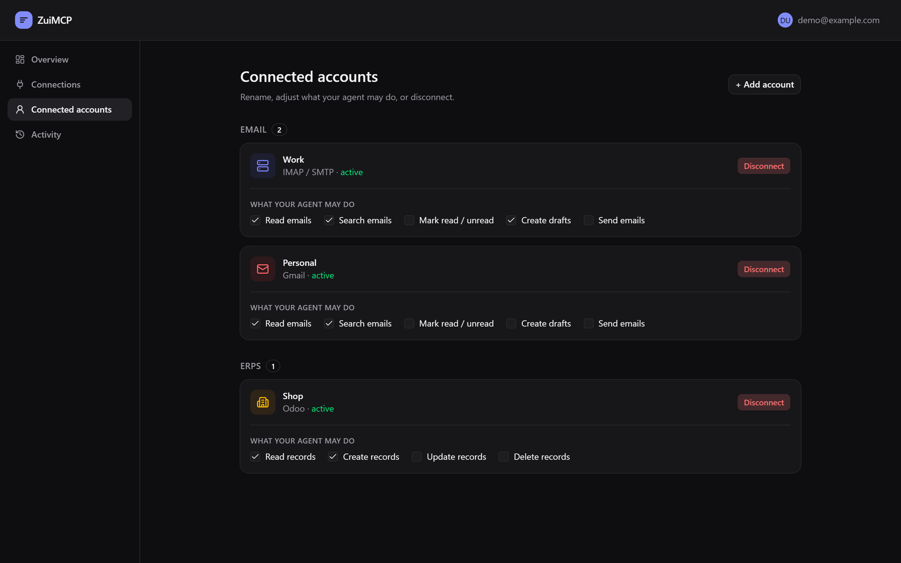
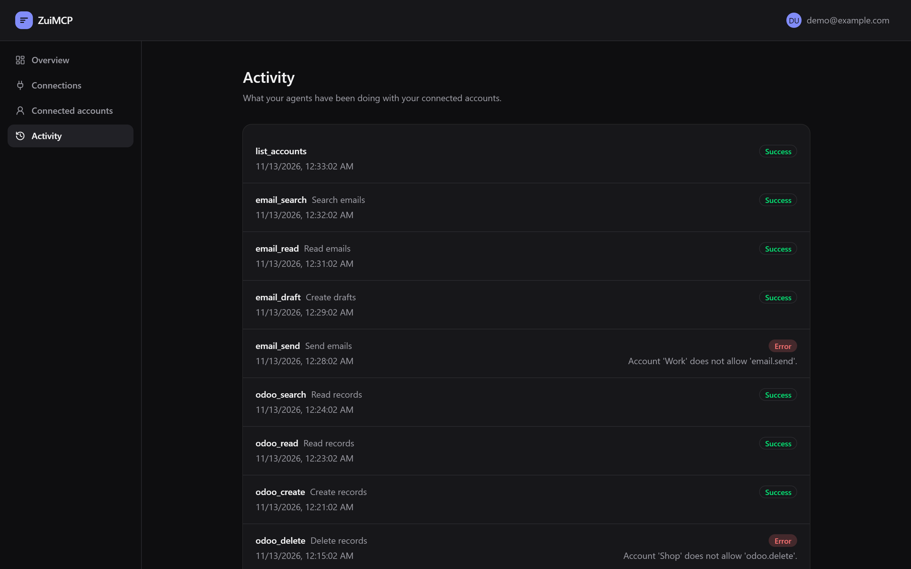
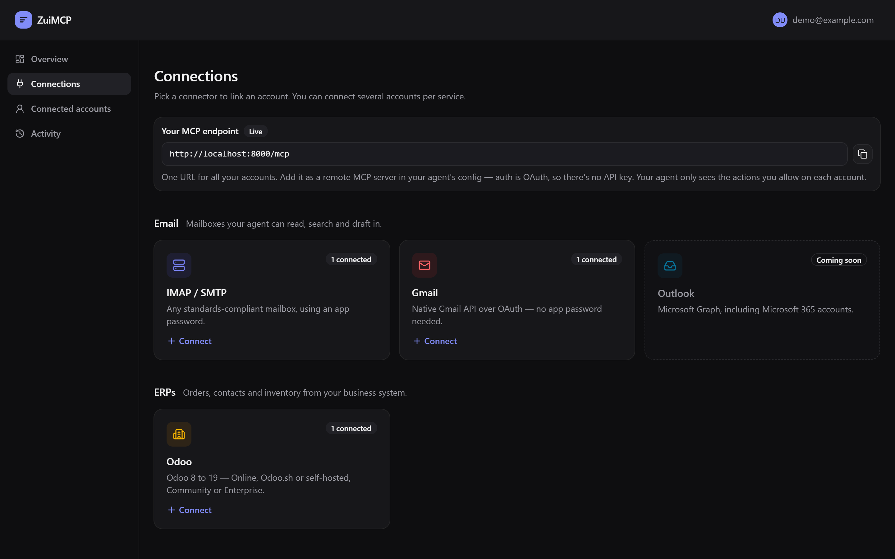
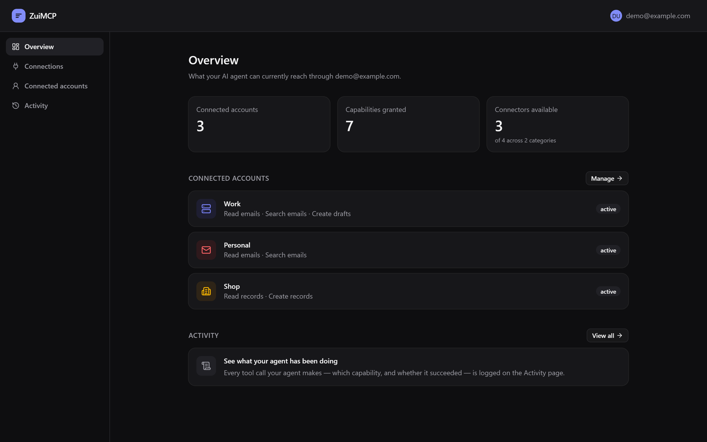
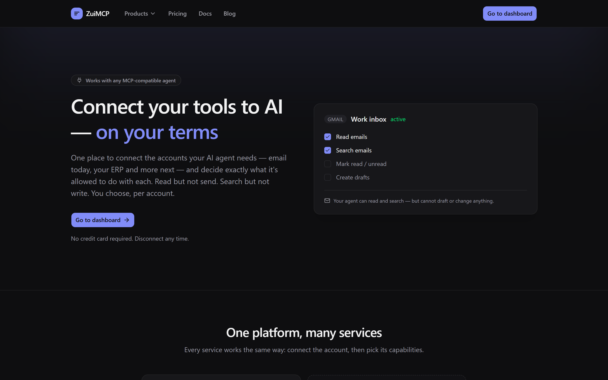
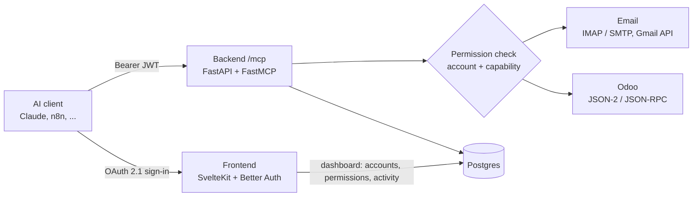

# ZuiMCP

[](https://github.com/khaihoan123/zuimcp/actions/workflows/ci.yml)
[](LICENSE)

**One safe MCP endpoint for all your apps and APIs, with you deciding exactly what each AI agent may do.**



ZuiMCP is a multi-tenant [MCP](https://modelcontextprotocol.io) platform. You connect your
accounts once, choose what an agent may do on each one (read, search, draft, send, create,
update, delete), and add a single URL to Claude, n8n or any MCP client. The agent signs in
with OAuth and only ever sees the actions you allowed.

The goal is to connect any API or MCP server behind the same permissions, account
selection and audit log. Email and Odoo come first.

> **Status:** early, under active development. IMAP/SMTP, Gmail and Odoo (8 to 19)
> work today. Microsoft 365 is planned.

## Why

Giving an AI agent your mailbox password or an Odoo admin key gives it everything.
ZuiMCP sits in between:

- **Closed by default.** Every action is off until you turn it on, per account.
  "Read and draft, but never send" is one toggle.
- **The agent never guesses the account.** With several mailboxes or databases,
  every call must name the account. A call without one fails and lists the choices,
  so an email can't go out from the wrong address.
- **Agents only see what they may use.** Tools no account allows are hidden from the
  agent's tool list, and they're refused anyway if called.
- **One endpoint for everything.** Add `/mcp` once; email and Odoo tools appear under it.

Every call is logged. Here, an agent tried to send from an account that may only draft,
and to delete Odoo records it may only read and create. Both were refused:



## Features

- **Connectors**
  - **Email:** any IMAP/SMTP mailbox (e.g. cPanel hosting), and Gmail through the native Gmail API with "Connect with Google".
  - **Odoo:** versions 8 to 19. It picks Odoo 19's JSON-2 API or the classic JSON-RPC API automatically.
- **Several accounts per service**, e.g. work and personal mailboxes, or production and test Odoo databases.
- **Standard MCP OAuth 2.1**: discovery, dynamic client registration and PKCE. No API keys to copy into the AI client.
- **Activity log**: every tool call is recorded with its capability and result, but never with message contents.
- **Rate limiting**: a per-user cap, so a runaway agent loop can't hammer your mailbox or ERP.
- **Security**:
  - credentials are encrypted at rest (Fernet), and no email is stored, because messages are fetched live;
  - an SSRF guard refuses private and internal hosts, re-checked on every connection;
  - Odoo requests never follow redirects.

## How it works



<details>
<summary>More screenshots</summary>




</details>



| Part | Stack | Role |
|---|---|---|
| `frontend/` | SvelteKit, Svelte 5, Tailwind v4, shadcn-svelte, Better Auth | Sign-in, OAuth 2.1 authorization server, dashboard |
| `backend/` | Python, FastAPI, FastMCP, SQLAlchemy, Alembic, httpx | MCP resource server at `/mcp`, REST API for the dashboard |
| Postgres | | Users and sessions (Better Auth), connections, permissions, audit log |

## MCP tools

Tools are named `<service>_<action>`. Every tool takes an optional `account` argument,
which is required when the user has more than one account for that service.

| Tool | Capability |
|---|---|
| `list_accounts` | none (lists your accounts and what each one allows) |
| `email_list_folders`, `email_list`, `email_read`, `email_get_attachment` | `email.read` |
| `email_search` | `email.search` |
| `email_draft` | `email.draft` |
| `email_send` | `email.send` |
| `email_mark_seen` | `email.mark_seen` |
| `odoo_list_models`, `odoo_get_fields`, `odoo_search`, `odoo_read`, `odoo_count`, `odoo_read_group` | `odoo.read` |
| `odoo_create` | `odoo.create` |
| `odoo_update` | `odoo.write` |
| `odoo_delete` | `odoo.delete` |

There is deliberately no "call any method" tool. Odoo's own access rights still apply
on top. Connect Odoo with a dedicated user whose rights match what the agent should do.

## Local development

Requirements: Python 3.12+ with [uv](https://docs.astral.sh/uv/), Node 20+, Postgres.

```bash
# 1. Frontend (auth server + dashboard), http://localhost:5173
cd frontend
cp .env.example .env          # fill in DATABASE_URL and BETTER_AUTH_SECRET
npm install
npx @better-auth/cli migrate  # creates the user/session/oauth tables
npm run dev

# 2. Backend (MCP + API), http://localhost:8000
cd backend
# create backend/.env with DATABASE_URL and CREDENTIALS_ENCRYPTION_KEY
uv sync
uv run alembic upgrade head   # run after the Better Auth migration (foreign key to user.id)
uv run fastapi dev main.py
```

Then sign up at http://localhost:5173, connect a mailbox or Odoo database, turn on the
actions you want, and add `http://localhost:8000/mcp` as a custom connector in your MCP client.

Generate secrets with:

```bash
openssl rand -base64 32                                                                    # BETTER_AUTH_SECRET
python -c "from cryptography.fernet import Fernet; print(Fernet.generate_key().decode())"  # CREDENTIALS_ENCRYPTION_KEY
```

Defaults live in `backend/config.yaml`; environment variables override them. Gmail needs
a Google Cloud OAuth client, see [DEPLOY.md](DEPLOY.md#gmail-mailboxes-optional).

### Running tests

The backend tests need Postgres. They use a separate database whose name ends in
`_test` (by default your `DATABASE_URL` with `_test` appended; create it once with
`createdb mcp_platform_test`), and drop all its tables on every run. External services
(IMAP, SMTP, Google, Odoo) are faked, so no real mail is sent.

```bash
cd backend && uv run pytest              # or set TEST_DATABASE_URL explicitly
cd frontend && npm run check
```

GitHub Actions runs both on every push and pull request.

### Single-user stdio mode

For a quick local test without the dashboard, set `EMAIL_ADDRESS` and `EMAIL_PASSWORD`
in `backend/.env`, point `IMAP_HOST`/`SMTP_HOST` in `config.yaml` at your server, and run:

```bash
uv run python main.py stdio
```

## Self-hosting

Docker Compose with Caddy for TLS. See [DEPLOY.md](DEPLOY.md).

## Roadmap

- Microsoft 365 / Outlook (Microsoft Graph)
- "Ask me first": require your approval before risky actions, such as sending an email
- More connectors, defined declaratively so new APIs need little code

## Contributing

See [CONTRIBUTING.md](CONTRIBUTING.md). Security issues: [SECURITY.md](SECURITY.md).

## License

[AGPL-3.0](LICENSE). If you run a modified version as a service, you must share your
changes under the same license. Contributions are accepted under a Contributor License
Agreement, so the project can also be offered under a commercial license.
